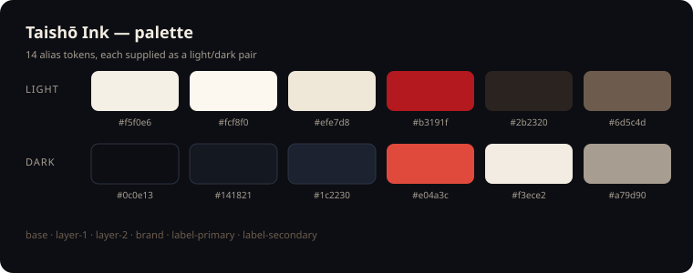

<div align="center">

# dsh-taisho-ink

**A Taishō-era ink-and-crimson theme for DeepSeek Harness.**

Washi paper and ink by day, ink and ember by night — with drifting embers,
wisteria petals and a nichirin-sun crest. The palette is applied through theme
tokens, so layout, controls and behaviour stay the host's.

*A theme bundle for [DeepSeek Harness](https://github.com/deepseek-ai/deepseek-harness).*

[](https://github.com/deepseek-ai/deepseek-harness)
[](./LICENSE)
[](https://github.com/topics/dsh-plugin)
[](https://github.com/deepseek-ai/deepseek-harness)
[](https://github.com/xbbkok/dsh-taisho-ink/actions/workflows/ci.yml)
[](https://github.com/xbbkok/dsh-taisho-ink/releases)

[中文](./README.zh.md) · **English**

</div>

---



## Why

Harness ships one neutral palette. Recolouring it by hand means fighting hashed
class names, and a second stylesheet breaks whenever the shell changes. This
package does neither: it overrides the documented `--dsw-alias-*` variables
through the theme service, and adds one click-through ambience layer beside the
existing UI — so the shell keeps owning its own layout.

## What it changes

| | |
|---|---|
| 🎨 **Palette** | 14 alias tokens: base and layered surfaces, borders, brand accent, labels, states, sidebar fill |
| 🌗 **Light / dark** | Both palettes are supplied at once and follow the Appearance switch |
| 🔥 **Embers** | 18 particles rising from the bottom edge, swaying as they fade |
| 🌸 **Wisteria** | 10 petals falling and swinging, in low-opacity violet |
| 🗡️ **Crest** | A crimson sun, a nichirin blade and a gold ring before the blank-session headline |
| ✨ **Details** | Crimson text selection and a rounded, brand-tinted scrollbar |
| ♿ **Reduced motion** | Particles and animations stop under `prefers-reduced-motion: reduce` |
| 🌐 **Localized** | English and Chinese display metadata; the plugin row follows the DSH language |
| 📦 **Self-contained** | No images, no fonts, no network, no storage — tokens, CSS and inline SVG only |

## Palette

| Token | Light | Dark |
|---|---|---|
| `--dsw-alias-bg-base` | `#f5f0e6` | `#0c0e13` |
| `--dsw-alias-bg-layer-1` | `#fcf8f0` | `#141821` |
| `--dsw-alias-bg-layer-2` | `#efe7d8` | `#1c2230` |
| `--dsw-alias-bg-overlay` | `#fffbf3` | `#171c26` |
| `--dsw-alias-border-l1` | `#ded1ba` | `#2c3343` |
| `--dsw-alias-border-l2` | `#c8b694` | `#455068` |
| `--dsw-alias-brand-primary` | `#b3191f` | `#e04a3c` |
| `--dsw-alias-label-primary` | `#2b2320` | `#f3ece2` |
| `--dsw-alias-label-secondary` | `#6d5c4d` | `#a79d90` |
| `--dsw-alias-state-error-primary` | `#c62828` | `#ff5b50` |
| `--dsw-alias-state-idle-primary` | `#b5a693` | `#6a7280` |
| `--dsw-alias-state-success-primary` | `#2f7d5f` | `#4fae8a` |
| `--dsw-alias-state-warn-primary` | `#c98612` | `#e8b04a` |
| `--dsw-specific-sidebar-fill` | `#ece2d0` | `#090b10` |

## Install

### As a bundle (recommended)

The package declares `dsh.bundle.patch`, so the official CLI also mounts the
plugin row:

```bash
dsh plugin --profile web add github:xbbkok/dsh-taisho-ink
```

Use `desktop` instead of `web` on the desktop app, then reopen DSH.

### From a local checkout

Append an `insert` entry to the profile's `cordis.patch.yml`. The loader uses
`import()`, so the specifier **must be a `file://` URL** — a bare Windows path
fails silently:

```yaml
- insert:
    - id: dsh-taisho-ink
      name: 'file:///C:/path/to/dsh-taisho-ink/lib/index.js'
```

Profile patch locations:

| Build | Path |
| --- | --- |
| Desktop | `%USERPROFILE%\.dsh\profiles\desktop\cordis.patch.yml` |
| Web | `%USERPROFILE%\.dsh\profiles\web\cordis.patch.yml` |

The row is keyed by id, so a later bundle install overrides the same row instead
of mounting a second copy.

## Usage

There is nothing to configure. After install, the theme applies immediately:

1. Open **Settings → Plugins** to confirm the row is enabled.
2. **Appearance** still switches light / dark / system — both palettes are part
   of the theme.
3. Disable or remove the bundle to get the stock palette back; every registration
   is disposed with the plugin.

## How it works

The browser half registers three things, all inside `apply`:

| Registration | Purpose |
|---|---|
| `ctx.theme.overrideTokens('dsh-taisho-ink', TOKENS)` | The 14 alias tokens as `{ light, dark }` pairs; stacked above the active theme and removed on unload |
| `shell.overlay` entry `dsh-taisho-ink.atmosphere` | The click-through glow, washi texture, embers and petals; the stylesheet lives in this component and disappears with it |
| `conversation.hero.brand.mark` | The crest shown before the blank-session headline |

No DOM outside the plugin's own components is written, no class name of the host
is targeted, and no data is stored or fetched.

## Compatibility

- DeepSeek Harness 0.2.x, web client (desktop and browser).
- Slots used: `shell.overlay`, `conversation.hero.brand.mark`.
- No Host service, route, tool or setting is registered.

## Development

```
.
├── lib/index.js        Host half — no behaviour, only the Loader row
├── lib/client.js       Browser half — tokens, ambience, crest
├── locale/en.json      Plugin Manager title and description (default)
├── locale/zh.json      Chinese metadata
├── icon.svg            Plugin list artwork
├── docs/palette.svg    Palette card used by this README
├── test/run-tests.mjs  Offline checks
└── .github/workflows   CI
```

```bash
npm test
```

No build step and no runtime dependencies: `lib/client.js` is the shipped
browser script. The suite validates the manifest, the patch row, the locale
metadata, the artwork, the bundle shape and the slot ids, and fails if a local
path or credential-shaped string is found anywhere in the repository.

## Credits

The aesthetics reference Taishō-era print and anime colour language; all vector
artwork in this repository is original. This project is not affiliated with,
endorsed by, or sponsored by any anime, game or character rights holder.

## License

[MIT](./LICENSE) © 2026 xbbkok
