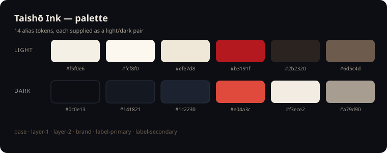

<div align="center">

# dsh-taisho-ink

**给 DeepSeek Harness 的大正墨染主题。**

白天是和纸与墨色，夜晚是墨夜与余烬——配以飘散的余烬、紫藤花瓣与日轮纹章。
配色全部通过主题 token 覆盖，布局、控件与交互保持宿主原样。

*面向 [DeepSeek Harness](https://github.com/deepseek-ai/deepseek-harness) 的主题插件包。*

[](https://github.com/deepseek-ai/deepseek-harness)
[](./LICENSE)
[](https://github.com/topics/dsh-plugin)
[](https://github.com/deepseek-ai/deepseek-harness)
[](https://github.com/xbbkok/dsh-taisho-ink/actions/workflows/ci.yml)

**中文** · [English](./README.md)

</div>

---



## 为什么做它

Harness 只带一套中性配色。手工改色意味着和哈希类名搏斗，而另写一份样式表会在
shell 升级时失效。这个包两件事都不做：它通过主题服务覆盖官方文档里的
`--dsw-alias-*` 变量，并在现有 UI 旁边加一层点击穿透的氛围层——布局仍然归宿主管。

## 它改了什么

| | |
|---|---|
| 🎨 **配色** | 14 个 alias token：底层与叠层表面、边框、主色、文字、状态色、侧栏底色 |
| 🌗 **亮/暗** | 两套调色板同时提供，跟随「外观」开关 |
| 🔥 **余烬** | 18 颗粒子从底边升起，边漂移边淡出 |
| 🌸 **紫藤** | 10 片花瓣旋转飘落，低透明度紫色 |
| 🗡️ **纹章** | 空会话页标题前：朱红日轮 + 日轮刀 + 金环 |
| ✨ **细节** | 朱红文字选中色、圆角品牌色滚动条 |
| ♿ **减少动态** | 系统开启 reduced motion 时，粒子与动画停止 |
| 🌐 **本地化** | 中英文显示元数据，插件行跟随 DSH 语言 |
| 📦 **零依赖** | 没有图片、字体、网络请求或存储——只有 token、CSS 和内置 SVG |

## 配色

| Token | 亮色 | 暗色 |
|---|---|---|
| `--dsw-alias-bg-base` | `#f5f0e6` | `#0c0e13` |
| `--dsw-alias-bg-layer-1` | `#fcf8f0` | `#141821` |
| `--dsw-alias-bg-layer-2` | `#efe7d8` | `#1c2230` |
| `--dsw-alias-bg-overlay` | `#fffbf3` | `#171c26` |
| `--dsw-alias-border-l1` | `#ded1ba` | `#2c3343` |
| `--dsw-alias-border-l2` | `#c8b694` | `#455068` |
| `--dsw-alias-brand-primary` | `#b3191f` | `#e04a3c` |
| `--dsw-alias-label-primary` | `#2b2320` | `#f3ece2` |
| `--dsw-alias-label-secondary` | `#6d5c4d` | `#a79d90` |
| `--dsw-alias-state-error-primary` | `#c62828` | `#ff5b50` |
| `--dsw-alias-state-idle-primary` | `#b5a693` | `#6a7280` |
| `--dsw-alias-state-success-primary` | `#2f7d5f` | `#4fae8a` |
| `--dsw-alias-state-warn-primary` | `#c98612` | `#e8b04a` |
| `--dsw-specific-sidebar-fill` | `#ece2d0` | `#090b10` |

## 安装

### 作为 bundle（推荐）

包内声明了 `dsh.bundle.patch`，官方 CLI 会同时挂载插件行：

```bash
dsh plugin --profile web add github:xbbkok/dsh-taisho-ink
```

桌面端把 `web` 换成 `desktop`，然后重新打开 DSH。

### 从本地目录挂载

在 profile 的 `cordis.patch.yml` 里追加一条 `insert`。加载器用 `import()`，
所以 specifier 必须是 `file://` URL——裸 Windows 路径会静默失败：

```yaml
- insert:
    - id: dsh-taisho-ink
      name: 'file:///C:/path/to/dsh-taisho-ink/lib/index.js'
```

profile patch 位置：

| 构建 | 路径 |
| --- | --- |
| 桌面端 | `%USERPROFILE%\.dsh\profiles\desktop\cordis.patch.yml` |
| Web | `%USERPROFILE%\.dsh\profiles\web\cordis.patch.yml` |

行以 id 为键，之后安装 bundle 会覆盖同一行，而不是挂载第二份。

## 使用

装上即生效，没有需要配置的选项：

1. 打开 **设置 → 插件**，确认该行已启用。
2. **外观** 仍可切换 亮色 / 暗色 / 跟随系统——两套配色都在主题里。
3. 停用或移除该 bundle 即可恢复默认配色；所有注册项随插件一起卸载。

## 实现

浏览器半边在 `apply` 里注册三样东西：

| 注册 | 作用 |
|---|---|
| `ctx.theme.overrideTokens('dsh-taisho-ink', TOKENS)` | 14 个 alias token 的 `{ light, dark }` 组合，叠加在当前主题之上，卸载即移除 |
| `shell.overlay` 条目 `dsh-taisho-ink.atmosphere` | 点击穿透的光晕、和纸纹理、余烬与花瓣；样式表随组件挂载，组件卸载后消失 |
| `conversation.hero.brand.mark` | 空会话页标题前的纹章 |

不写插件组件之外的 DOM，不针对宿主的类名做选择器，不存储也不请求任何数据。

## 兼容性

- DeepSeek Harness 0.2.x，Web 客户端（桌面端与浏览器）。
- 使用槽位：`shell.overlay`、`conversation.hero.brand.mark`。
- 不注册任何 Host 服务、路由、工具或设置项。

## 开发

```
.
├── lib/index.js        Host 半边 —— 无行为，只为 Loader 提供行
├── lib/client.js       浏览器半边 —— token、氛围层、纹章
├── locale/en.json      插件管理器的标题与描述（默认）
├── locale/zh.json      中文元数据
├── icon.svg            插件列表图标
├── docs/palette.svg    README 使用的配色卡
├── test/run-tests.mjs  离线检查
└── .github/workflows   CI
```

```bash
npm test
```

没有构建步骤、没有运行时依赖：`lib/client.js` 就是发布的浏览器脚本。
测试会校验清单、patch 行、语言元数据、图标、bundle 形状与槽位 id，并且在仓库里
出现本地路径或凭据样式字符串时直接失败。

## 致谢

美学参考大正时代的印刷与动画配色语言；本仓库中的矢量图形均为原创。
本项目与任何动画、游戏或角色版权方无关联，也未获其背书或赞助。

## 许可

[MIT](./LICENSE) © 2026 xbbkok
